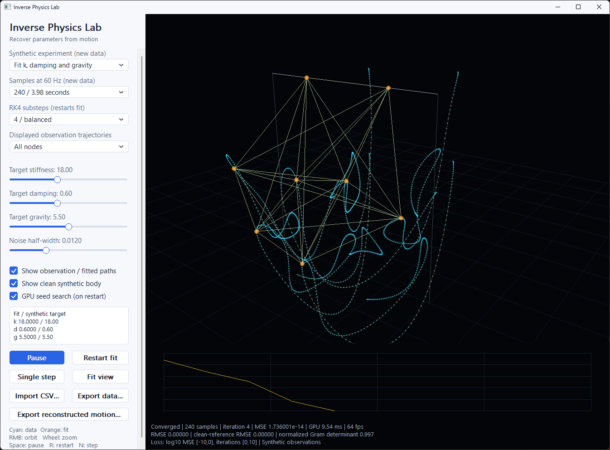

# Inverse Physics Lab — 3D GPU parameter estimation



**Interface update:** This project uses the shared modern WinAPI interface: flat themed controls, scrollable settings and keyboard navigation. See [Modern UI](../../MODERN_UI.md). Simulation shortcuts apply when the 3D canvas has focus; focused controls use their native keys.

Recover physical parameters from observed motion of a **three-dimensional spring network**. OpenGL compute shaders simulate trial trajectories, build a finite-difference Jacobian, reduce normal equations, solve parameter updates and choose decreasing steps. A native interface displays the reconstructed body, observations, residuals and convergence history.

The project uses **C++23, WinAPI/WGL, Visual Studio 2026 and OpenGL 4.3 Core**. It has no third-party libraries, package managers, downloaded assets or external shader files. The interface and documentation are in English.

## Build and run

1. Install Visual Studio 2026 with **Desktop development with C++**, **MSVC v145** and a Windows SDK.
2. Open `InversePhysicsLab3D.sln`, select **Release | x64**, and build/run `07_InversePhysicsLab`.
3. Alternatively, run `./BuildInversePhysics3D.ps1`. The executable is `bin/x64/Release/07_InversePhysicsLab.exe`. Use `-Configuration Debug` for a Debug build.

The complete collection also builds the application through `PhysicsLab.sln`. The standalone solution has no reference to other projects or `PhysicsCore`. The collection's old `Simulation.cpp` remains only as a historical CPU regression solver; it is not compiled into this executable or included in the standalone archive.

Both configurations use the static Microsoft C++ runtime. The tested compiler is MSVC 14.51.36231 with `/std:c++23preview`, the C++23 switch supported by that toolset. Runtime requirements are Windows, an interactive desktop and a graphics driver supporting **OpenGL 4.3 Core with compute shaders**. Context or shader failures produce an error instead of silently using a CPU solver. Minimum window size is 1080 × 1000 physical pixels; a 1080p or larger desktop is recommended.

## Experiments

| Experiment | Estimated parameters and observations |
|---|---|
| Fit k, damping and gravity | Recover stiffness, isotropic velocity damping and downward gravity magnitude from clean 3D positions of all six free nodes. |
| Noisy 3D observations | Fit the same three parameters with reproducible independent uniform coordinate noise. |
| Sparse and noisy observations | Observe only nodes 0, 2 and 5, every fourth sample; fit all three parameters and reconstruct the complete motion. |
| Stiffness only (d, g known) | Fit stiffness while supplying the true damping and gravity as known calibration. |

The sample interval is fixed at **1/60 model second**, including the initial state at sample zero. The interface offers 120, 240 or 360 samples (last timestamps approximately 1.98, 3.98 or 5.98 seconds). The RK4 integrator uses four or eight substeps per interval. Defaults are 240 samples and four substeps.

| Synthetic-data slider | Range | Default |
|---|---|---|
| Target stiffness | 10–30 | 18 |
| Target damping | 0.20–1.20 | 0.60 |
| Target gravity magnitude | 3–8 | 5.5 |
| Noise half-width | 0–0.04 in each coordinate | 0.012 |

Noise applies only to the noisy and sparse presets. Its distribution is uniform on `[-halfWidth, +halfWidth]`, not Gaussian. Synthetic-data sliders regenerate observations and restart estimation. They are disabled for imported observations. Selecting a synthetic experiment exits imported-data mode and creates a new synthetic dataset.

## Interaction and display

| Control | Behavior |
|---|---|
| Right mouse drag / wheel | Orbit / zoom the perspective camera. |
| Fit view | Restore the standard camera framing for the spring body. |
| Space / Pause | Pause or resume fitting and motion playback. |
| R / Restart fit | Reset the parameter estimate and optimizer history. Imported observations are retained. |
| N / Single step | Pause and execute one optimizer iteration, advancing playback by one sample. Once fitting has stopped, only playback advances. |
| Displayed observation trajectories | Show paths for all nodes or a selected node; does not change the fitting objective. |
| Show observation / fitted paths | Toggle cyan observation points and orange fitted trajectories. |
| Show clean synthetic body | Toggle the noise-free reference body's current wireframe. Unavailable for imported data. |
| GPU seed search | Enable/disable the initial coarse parameter search on the next restart. |
| Import CSV | Load observations matching the model and time convention below. |
| Export data | Export observations in the importable format. |
| Export reconstructed motion | Save observed and fitted positions for every sample and node, plus fitted parameter metadata. |
| Escape | Close the application. |

Orange points and springs are the fitted body; cyan points are measured positions. The thin cyan body is the optional clean synthetic reference. Pink segments at the current playback sample connect valid observations to the reconstruction. The reference is a visual/validation aid and is never used by the fitting objective. Anchor nodes 6 and 7 are fixed and do not contribute observation residuals in generated or imported datasets.

The lower graph shows **log10 weighted MSE**, clipped to `[-10, 0]` vertically. Its horizontal range begins at 0–10 iterations and expands in blocks of ten. The current axis range appears in the status text. It displays only recorded optimizer segments; it does not invent a descent after the last iteration.

Playback loops over the complete observed time interval, including after convergence. The floor grid and support posts are reference geometry, not collision surfaces. Lines and points use transparency without depth occlusion, so overlapping paths remain visible. This is a diagnostic view, not a physical photometric renderer.

## Forward model

There are eight unit-mass nodes, indexed by the bits of their rest-cube coordinates:

```text
rest.x = bit0 ? +0.25 : -0.25
rest.y = bit1 ?  1.00 :  0.50
rest.z = bit2 ? +0.25 : -0.25
```

Nodes 6 and 7 stay fixed at their rest positions. Every pair of nodes is connected, giving **28 springs**. A spring's rest length is the distance between its endpoints in the rest cube. Its stiffness multiplier is 1 for a cube edge, 0.7 for a face diagonal, and 0.45 for a body diagonal.

For each free node, with unit mass:

```text
x_i' = v_i
v_i' = (0, -g, 0) - damping × v_i
       + sum(j != i) stiffness × weight_ij × (|x_j-x_i| - restLength_ij)
                       × (x_j-x_i) / max(|x_j-x_i|, 1e-6)
```

Damping is isotropic drag against the reference frame, not spring-relative damping. Gravity direction, node masses, spring topology and all rest lengths are known. The three unknowns are positive scalar stiffness, damping and gravity magnitude.

Free nodes start from a rotated/offset rest shape: rotate XZ by 0.35 radians, then add `(0.10, 0, -0.06)`. The fixed nodes remain at rest. Initial free-node velocity, evaluated from the rest position and node index `i`, is `(0.4(0.5-z), 0.1x, 0.35+0.1i/8)`. Anchor velocities are zero. This excites motion outside any single plane. Initial conditions are known and **are not estimated**.

A classical four-stage **RK4** integrator advances the coupled positions and velocities at `h = 1/(60 × substeps)`. A compute workgroup owns all eight nodes for one candidate trajectory. Shared-memory barriers separate force evaluations and stage updates. Different candidate trajectories run in parallel workgroups; there are no CPU position updates or CPU force evaluations in normal operation.

This is a small lumped spring-network model, not a calibrated finite-element material. Springs can stretch or compress, nodes can pass through other nodes, and the model has no floor contact, self-collision, plasticity or fracture.

## Inverse method

The optimizer minimizes a weighted coordinate MSE:

```text
objective = sum(sample,node) weight × |predictedPosition - observation|²
            / (3 × sum(sample,node) weight)
```

A weight applies equally to all three coordinates of one node/sample. Zero weight masks that observation completely. There is no robust outlier loss or automatic correspondence matching.

Parameters are represented internally as `q = log(stiffness, damping, gravity)` with bounds:

```text
stiffness: 4 .. 50
damping:   0.03 .. 3
gravity:   0.3 .. 12
```

The initial estimate is `(10, 1.2, 8)`. In stiffness-only mode, damping and gravity instead use the supplied calibration. When enabled, a GPU seed search tests the current estimate and 32 combinations: eight stiffness values `10,13,...,31`, two damping values `0.3,1.1`, and two gravity values `4,7`. It accepts only a lower objective. Known parameters stay fixed in stiffness-only mode.

Each subsequent iteration runs entirely on compute shaders:

1. Simulate the current trajectory plus positive/negative log-parameter perturbations, seven trajectories in total.
2. Build central finite-difference derivatives with `delta q = 0.002` and reduce `Jᵀ W J`, `Jᵀ W r`, residual sums and weights.
3. Solve a pivoted 3 × 3 system with a Levenberg–Marquardt-style diagonal regularizer, initially `lambda = 0.01`. Limit the proposed log-space step length to 0.7.
4. Evaluate eight bounded candidate steps with scales `1, 1/2, ..., 1/128` in parallel. Accept the best only if its improvement exceeds `max(1e-11, oldObjective × 1e-6)`.
5. On acceptance, multiply lambda by 0.4 (floor `1e-7`); otherwise multiply it by 10 (ceiling `1e6`). Recompute the accepted trajectory and diagnostics.

This is a damped Gauss–Newton method with batched backtracking, not automatic differentiation or a complete general-purpose trust-region package. The one-parameter mode freezes the two supplied parameters in the solve. The GPU performs both the small linear solve and the step acceptance; the CPU does not solve normal equations or pick candidate parameters.

Fitting stops when MSE falls below `1e-10`, the proposed log-step norm falls below `1e-4`, 100 iterations have run, or regularization reaches its upper limit. The interface distinguishes convergence from a stopped fit. Convergence is a numerical stopping condition, not proof of a unique or global solution. The seed search improves the starting point but does not guarantee global optimization.

## Diagnostics and GPU resources

The UI displays estimates and synthetic truth (when available), iteration count, weighted MSE, per-coordinate RMSE, clean-reference RMSE, GPU time and a normalized Gram determinant. Clean-reference RMSE compares the full reconstructed trajectory against all six free nodes of the noise-free synthetic trajectory; it is not a strictly held-out score. Imported data report it as unavailable.

The normalized Gram determinant is `det(Jᵀ W J)/(H00 H11 H22)` for three active parameters. It is a sensitivity diagnostic, not a full condition number, covariance estimate or confidence interval. A missing residual set, negligible stiffness sensitivity or normalized determinant below `1e-7` stops the fit as uninformative. In one-parameter mode, a valid scalar sensitivity is reported as 1.

Eight SSBO bindings hold optimizer state, trial trajectories, observations, the synthetic reference, normal-equation partials, candidates, convergence history and computed line vertices. A GPU geometry pass constructs the 3D paths, current spring bodies, residual vectors and convergence graph. Rendering uses vertex attributes, so it does not require vertex-stage SSBO support beyond OpenGL 4.3's minimum. Storage, vertex-attribute and readback barriers make the dispatch/render transitions explicit.

The CPU creates the window, handles files and camera controls, schedules dispatches and reads an **80-byte state summary per iteration**. Full readback is limited to exports, verification, and preserving imported data across restart. Normal fitting never transfers whole trial trajectories to the CPU. The independent double-precision implementation in the source is called only by `--gpu-test`.

GPU time is the latest completed optimizer-iteration query, including trial simulation, reductions, selection and geometry-independent diagnostics. It excludes rendering and CPU readback. The result may lag, initially shows zero, and remains the last fitting time during playback after convergence. Rendering FPS is not an optimization-iteration rate. A slow device slows the nominal 60 Hz scheduling instead of enlarging the integration step.

## CSV observation format

A file must contain a sample-count declaration followed by the exact numeric header:

```csv
# samples=240
sample,node,x,y,z,weight
0,0,-0.2205676,0.5,-0.2091187,1
0,1,0.2491187,0.5,-0.3805676,1
```

The rows above illustrate syntax only; a usable dataset needs at least twelve positive-weight free-node rows across multiple sample times. Export data from the app to obtain a complete working example.

- `samples` must be 8–360. The UI presets are 120/240/360; an imported file can use any count in the permitted range.
- `sample` is an integer index with time **sample / 60**, starting at zero; there is no arbitrary timestamp column or resampling.
- `node` is an integer 0–7 with the fixed ordering above. Nodes 6 and 7 have their weights forced to zero.
- X, Y and Z are absolute world positions in the model's coordinate frame and normalized units. Values must be finite and within ±100.
- Weight must be finite and in `[0,1]`. Missing rows are treated as weight zero. Duplicate sample/node pairs are rejected.
- The parser accepts blank lines, `#` comments, optional UTF-8 BOM and surrounding whitespace. Numeric fields use a decimal point. Quoted fields, extra columns and malformed numbers are rejected. Files are limited to 4 MiB.

Imported observations must match **this spring topology, rest geometry, masses, gravity direction, time origin and initial conditions**. Arbitrary motion capture, a different coordinate frame, unknown launch velocity or another object model will generally not fit. Importing a file does not infer these missing assumptions. Use the three-parameter mode unless damping and gravity are independently known; set that calibration before importing into stiffness-only mode.

Import parsing finishes before replacing the current dataset. For imported data, the optimizer does not read a hidden synthetic trajectory or true parameters. The observation export intentionally contains no true parameter values. Reconstructed-motion export is a separate analysis table and is not an observation-import file.

## Verification and limitations

Run `./TestInversePhysics3D.ps1` after a Release build. It creates a real graphics context and requires a fresh `ALL PASSED` report. `ValidationInversePhysics3D` receives numerical results, real framebuffer captures and example observation/reconstruction CSV files.

Tests cover independent double-precision RK4 trajectories, fixed anchors, out-of-plane motion, finite-difference Jacobians, normal-equation reductions and partial workgroups; parameter recovery across presets/ranges; monotone objective history; sparse/high-noise data; known-parameter preservation; repeatability; CSV round-trip and malformed inputs; blinded imported fits; masked observations; uninformative data; UI controls and rendering. `--smoke` runs 180 default simulation/rendering frames and writes `Lab07_smoke.txt` and `Lab07.bmp` in the working directory. These modes briefly open a non-activating window and require an interactive graphics session.

Synthetic observations use the same forward model as estimation. Excellent recovery therefore demonstrates internal consistency, not robustness to unmodeled real-world physics. Independent double tests measure numerical agreement, while real inverse problems also require model validity, informative measurements, appropriate noise assumptions and calibration. The program provides no uncertainty intervals or scientific validation for a particular physical material. See `ValidationInversePhysics3D/VALIDATION.md` for measured results and tested hardware.

## Source map and reading references

| File | Responsibility |
|---|---|
| `Inverse3D.cpp` | GPU resources, native UI, fitting orchestration, display/export, smoke and numerical verification. |
| `InverseShaders.hpp` | Forward RK4 model, observations, candidate search, Jacobian, normal equations, solve, acceptance and render geometry. |
| `ObservationIO.hpp` | Strict numeric observation CSV parser and dataset container. |
| `Math3D.hpp` | Small vector/matrix types and perspective camera. |
| `GpuApi.hpp` | WGL context, explicit GL entry-point loading and shader diagnostics. |
| `07_InversePhysicsLab.vcxproj` | Visual Studio 2026 C++23 application project. |

These references are background reading, not dependencies or included third-party source:

- [Ceres documentation: Nonlinear Least Squares](https://ceres-solver.readthedocs.io/latest/nnls_solving.html), for damped least-squares concepts. This application does not link or use Ceres.
- [Khronos: glMemoryBarrier](https://wikis.khronos.org/opengl/GLAPI/glMemoryBarrier)
- [Khronos: Shader Storage Buffer Object](https://wikis.khronos.org/opengl/Ssbo)
